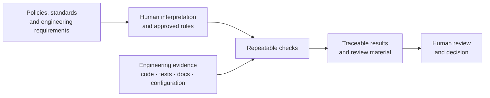
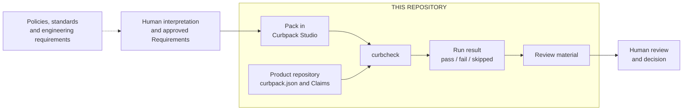

# Curbpack

Curbpack checks a software repository against selected requirements and prepares the results for human review. The same checks can be run locally or in CI/CD. The resulting material can be handed to QA, a buyer, or an auditor.

This repository contains two programs:

- **Curbpack Studio** is the human-facing application for creating and working with Packs, Requirements, Claims, evidence, checks, and reviews.
- **curbcheck** runs the repeatable checks. Studio uses it, and the same program can be run from a shell or CI/CD pipeline.

[Documentation](docs/README.md) · [Getting Started](docs/user-guides/getting-started.md) · [Install](docs/user-guides/install.md)

## Vision

Software teams increasingly need to show that a product fulfils technical requirements, company policies, security rules, standards, and other obligations. The relevant evidence already exists in many projects, in source code, configuration, tests, documentation, build results, and engineering records. Connecting a requirement to the right evidence, checking it consistently, and preparing it for review is still largely manual.

The long-term goal is a traceable path from **a requirement or policy**, through **explicit checks of engineering evidence**, to **a reviewable result**. Automation should perform the repetitive checking and preserve where each result came from. Humans remain responsible for interpreting requirements and policies, approving rules, reviewing the evidence, and deciding whether a product is ready to release or whether an external requirement has been fulfilled.

Curbpack is the repeatable checking and evidence-handling part of this flow. Curbpack does not decide what a law means, invent organisational policy, or make a compliance or release decision on behalf of a person.

## Current state

The full vision is not implemented. What this repository runs today is the pilot path below. A person interprets the source and approves the Requirements and Claims. Studio maintains that work. `curbcheck` evaluates the defined checks and writes a run result. Studio compiles that result into review material. A person reviews the material and decides what it means.

Discovery can suggest candidate files. Extract can propose unsigned Requirements. Neither is an approval, and neither produces a check result. Signing a Requirement, signing a Claim, and signing a review report are three separate acts.

A passing check means that the selected questions passed for the repository state that was evaluated. A person still decides what that means.

## A simple example

A Requirement may require vulnerability-reporting information in `SECURITY.md`. A person writes a Claim that points to that file and defines the checks to perform, such as whether the file exists and whether an expected heading is present. `curbcheck` checks the file against those questions. If a later commit removes the file or the heading, running the same check exposes the change.

The team updates the product evidence and runs the check again. A reviewer still decides whether the documented process is suitable and actually followed.

## Try it

Download Curbpack Studio and `curbcheck` from the [latest release](https://github.com/RI-SE/curbpack/releases). See [Install](docs/user-guides/install.md) for platform-specific instructions.

[Getting Started](docs/user-guides/getting-started.md) walks through Pack Editor, Discovery & Claims, Check, and Review.

## Start here

| You are | Start here |
| --- | --- |
| **New user** | [Install](docs/user-guides/install.md) · [Getting Started](docs/user-guides/getting-started.md) |
| **Buyer / reviewer** | [Reviewer guide](docs/user-guides/reviewers.md) |
| **Authority / auditor** | [Reviewer guide](docs/user-guides/reviewers.md) |
| **Pack author** | [Pack author guide](docs/user-guides/pack-developers.md) |
| **Builder / product team** | [Developer guide](docs/user-guides/developers.md) · [CI/CD](docs/user-guides/ci-cd.md) |
| **Curbpack contributor** | [Development](docs/development/README.md) · [Testing curbcheck](docs/testing/README.md) · [CONTRIBUTING.md](CONTRIBUTING.md) |

## For contributors

Development, testing, and packaging instructions are available in [Development](docs/development/README.md) and [Testing curbcheck](docs/testing/README.md). See [Architecture](docs/arch/ARCHITECTURE.md) for the system structure and [CONTRIBUTING.md](CONTRIBUTING.md) for contribution guidance.

## Project background

[Curbpack](https://github.com/RI-SE/curbpack) is developed by RISE as applied research and released under the Apache-2.0 licence. RISE does not certify products based on Curbpack results.
