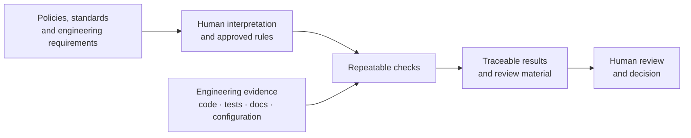
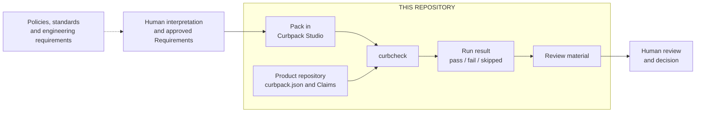

# Curbpack


Curbpack checks a software repository against selected requirements and prepares the result for a person to review. The checks run locally. A product team can hand that material to QA, a buyer, or an auditor.

This repository is the Curbpack source. It contains two programs:

- **Curbpack Studio** is the local application. It is where a person extracts Requirements into a Pack, looks for evidence, writes Claims, and reviews a run.
- **curbcheck** is the check program. Studio's Check page runs it, and a shell or CI job can run the same program with `python3 -m checks`.

[Documentation](docs/README.md) · [Getting Started](docs/user-guides/getting-started.md) · [Install](docs/user-guides/install.md)

## Vision

Software teams increasingly need to show that a product follows technical requirements, company policies, security rules, standards, and other obligations. The relevant evidence already exists in many projects — in source code, configuration, tests, documentation, build results, and engineering records — but connecting a requirement to the right evidence, checking it consistently, and preparing it for review is still largely manual.

The long-term goal is a traceable path from **a requirement or policy**, through **explicit checks of engineering evidence**, to **a reviewable result**. Automation should do the repetitive checking and preserve where each result came from. Humans remain responsible for interpreting policies, approving rules, reviewing the evidence, and making decisions such as whether a product is ready to release or whether an external requirement has been satisfied.



Curbpack is the repeatable checking and evidence-handling part of this flow. It does not decide what a law means, invent organizational policy, or make a compliance or release decision on behalf of a person.

## Current state

The full vision is not implemented. What this repository runs today is the pilot path below. A person interprets the source and approves the Requirements and the Claims. Studio keeps that work. curbcheck asks the technical questions on those Claims and writes one run result. Review compiles that result. A person decides.



Discovery can suggest candidate files. Extract can propose unsigned Requirements. Neither of those is an approval, and neither is a check result. Signing a Requirement, signing a Claim, and signing a review report are three separate acts.

A passing check means the selected questions passed for the repository state that was evaluated. It is not certification, CE marking, or a conformity assessment.

## A simple example

A Requirement may ask for vulnerability-reporting information in `SECURITY.md`. A person writes a Claim that points at that file and the questions to ask, such as whether the file exists and whether an expected heading is present. curbcheck checks the file against those questions. If a later commit removes the file or the heading, running the same check shows the change.

The team updates the product evidence and runs the check again. A reviewer still decides whether the documented process is suitable and actually followed.

## Start here

| You are | Start here |
| --- | --- |
| **New user** | [Install](docs/user-guides/install.md) · [Getting Started](docs/user-guides/getting-started.md) |
| **Builder / product team** | [Developer guide](docs/user-guides/developers.md) · [CI/CD](docs/user-guides/ci-cd.md) |
| **Buyer / reviewer** | [Reviewer guide](docs/user-guides/reviewers.md) |
| **Authority / auditor** | [Reviewer guide](docs/user-guides/reviewers.md) |
| **Pack author** | [Pack author guide](docs/user-guides/pack-developers.md) |
| **Curbpack contributor** | [Development](docs/development/README.md) · [Testing curbcheck](docs/testing/README.md) · [CONTRIBUTING.md](CONTRIBUTING.md) |

The CI/CD guide is how a product pipeline runs curbcheck. Curbpack's own tests are `make test` and `make ci-tests`.

## Try it

From a source checkout, after `python3 -m pip install -r requirements.txt`:

```bash
make start
```

Studio listens on `http://127.0.0.1:8770` unless you pass another port. The [Getting Started walkthrough](docs/user-guides/getting-started.md) uses a disposable reference product: select a Pack, write a Claim, break one piece of evidence, and run the check again.

The same check from a shell, with Studio and the packs kept outside the product tree:

```bash
python3 -m checks \
  --repo /path/to/product \
  --packs /path/to/packs \
  --out /path/to/product/.curbpack/run-result.json
```

Exit 0 means at least one check ran and every Claim and every check passed. Any other outcome is exit 1. A usage error is exit 2. In CI, fail the job on a non-zero status. Fix the product or the Claim, then let the job check the new revision. Human confirmation stays a human action.

`make package` builds the two programs for the machine it is run on: `curbpack-studio-<host>` is Curbpack Studio, and `curbcheck-<host>` is curbcheck. macOS ARM64 and Windows x64 are the hosted builds. A source checkout on any platform still uses `python3 -m checks`.

## For contributors

| Command | What it does |
| --- | --- |
| `make start` | Start Curbpack Studio |
| `make test` | Studio functional tests. Does not run the curbcheck catalogue |
| `make test-curbcheck` | Clone the pinned product, apply R1, run the carried checks, then report the catalogue |
| `make ci-tests` | The checks GitHub Actions runs. `ONLY=name` runs one |
| `make package` | Build and smoke-test both programs for this host |

Persistent Pack, Requirement, Claim, signature, and result fields are [Packs v2](docs/reference/packs2.md). Architecture is [docs/arch/ARCHITECTURE.md](docs/arch/ARCHITECTURE.md). Stories are under [docs/agile/](docs/agile/README.md).

## Project background

[RI-SE/curbpack](https://github.com/RI-SE/curbpack) is this repository: source, documentation, and the Studio and curbcheck workflows. Development is supported by RISE as applied research. RISE does not certify products that use Curbpack results.

License: Apache-2.0 (`LICENSE`).
