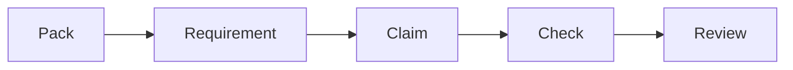
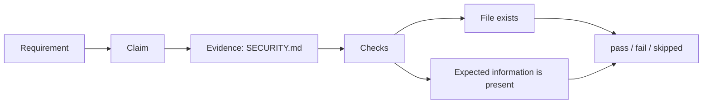
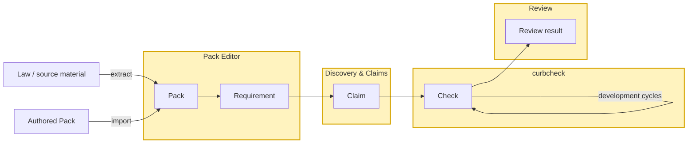

# Curbpack documentation

Curbpack helps a product team keep track of requirements, the evidence used to address those requirements, and whether that evidence is still in place as the product evolves.

The basic idea is:


*Figure 1. Curbpack's core concepts and their relationships.*


- **Packs** contain *Requirements* that apply to a product.
- **Requirements** describe what must be fulfilled, together with guidance on where to look for evidence in a repository and what to look for. 
- **Claims** connect those Requirements to evidence in a product repository.
- **Checks** monitor the Claims as the product changes.
- **Review** is where a person examines the results and decides what they mean.

Curbpack automates parts of this work, but it does not decide whether a product is compliant or certified.

## The basic concepts

### Packs and Requirements

A **Pack** is a versioned collection of Requirements.

Requirements may, for example, be derived from legislation such as the Cyber Resilience Act (CRA) or NIS2, from standards, or from other policies and engineering requirements.

Creating a useful Pack requires human judgement. Curbpack Studio can help extract candidate Requirements from source material using predefined adapters, but a person must review the result and decide what the Requirement actually says.

Packs do not have to belong to one particular product. An organisation can maintain reusable Packs in a shared Git repository and use them across several products. For a single product, Packs may instead live directly in the product repository.

### Claims and evidence

Once you know which Requirements apply to a product, the next question is:

> **What in this product gives us evidence that we address this Requirement?**

That connection is represented by a **Claim**.

A Claim describes the evidence and the checks that Curbpack should perform on it. For example, a Claim might say that a particular document must exist, contain some expected information, or have been updated within an acceptable period.

A Requirement can have any number of Claims.

Claims belong to the product repository because they describe what that particular product claims as evidence for its Requirements.

Curbpack Studio's **Discovery & Claims** view can help find candidate evidence. Discovery uses a local AI model to search the repository, guided by the search hints in `curbpack.json` and in individual Requirements. It suggests files that may be relevant and explains why they were found.

These are suggestions, not Claims. A person inspects the proposed evidence, decides whether it is actually relevant, and defines the checks that should be performed. Only then does it become part of the maintained Claim set.

### Checking the product

Once the Packs and Claims are in place, **curbcheck** can run the checks repeatedly.

This is intended to fit into the normal development process, including CI/CD. Instead of repeatedly searching through the whole repository manually, curbcheck asks the questions previously defined in the Claims and records the result.

For example:


*Figure 2. Example relationship between a Requirement, Claim, evidence and checks.*


If the product changes and one of those checks starts failing, the team knows which Claim and evidence need attention.

A failed check can also be a reason to run Discovery again. Evidence may have moved, been replaced, or new evidence may now exist elsewhere in the repository.

### Human responsibility

Curbpack deliberately keeps human decisions separate from automated checks.

A passing check means that the questions defined in the Claims passed for the repository state that was checked. **It does not mean that the product is certified or compliant.**

People remain responsible for:

- interpreting the original requirement;
- approving Requirements;
- deciding what constitutes relevant evidence;
- creating and approving Claims and their checks;
- reviewing check results;
- deciding whether the evidence is sufficient.

Signatures and signed Git commits can be used to preserve who approved what, depending on the organisation's procedures.

The purpose of automation is therefore not to replace review. It is to make previously defined checks repeatable and to make changes in the supporting evidence easier to find.

## The tools

Curbpack consists of two main programs:

- **Curbpack Studio** is the human-facing application for working with Packs, Requirements, Discovery, Claims, Check results, and Review.
- **curbcheck** performs the repeatable checks. It can be run from Studio or directly from a shell or CI/CD pipeline.

A useful way to think about the division is:

*Figure 3. Curbpack tools and the concepts they operate on.*

Studio helps people prepare and review the information. `curbcheck` performs the deterministic checking.

## The workflow

You do not have to perform every activity every time. Setting up a product involves selecting the applicable Packs, establishing Claims and defining their checks. Once that is in place, the normal development loop is much smaller:
```mermaid
flowchart TD
    A["Change product"] --> B["Run curbcheck"]
    B --> C{"Claims still hold?"}
    C -->|Yes| D["Continue development"]
    C -->|No| E["Inspect what changed"]
    E --> F["Update evidence or Claim"]
    F --> B
`Figure 4. The recurring Curbpack development cycle. 

Creating or changing Requirements and discovering new evidence are activities you return to when they are needed.

The Curbpack Studio cover page at `http://127.0.0.1:8770` provides access to these activities. They all operate on one selected product repository.


The repository's `curbpack.json` tells Curbpack where to find the Packs, Claims, results, reports, and search hints used for that product.

After this initial setup, Check can run directly whenever the configuration, selected Packs and Claims already exist. There is no requirement to run Extract or Discovery before every Check.

Importing a Pack and accepting an extracted Pack ultimately produce the same kind of persistent Pack data. They are two ways of obtaining a Pack, not two separate downstream workflows.

Optional `curbpack-studio.json` contains Studio-specific settings such as bind, model and temporary-file configuration.

## Start here

| You are | Start here |
| --- | --- |
| **New user** | [Install](user-guides/install.md) · [Getting Started](user-guides/getting-started.md) |
| **Buyer / reviewer** | [Reviewer guide](user-guides/reviewers.md) |
| **Authority / auditor** | [Reviewer guide](user-guides/reviewers.md) |
| **Pack author** | [Pack author guide](user-guides/pack-developers.md) |
| **Builder / product team** | [Developer guide](user-guides/developers.md) · [CI/CD](user-guides/ci-cd.md) |
| **Curbpack contributor** | [Development](development/README.md) · [Architecture](arch/ARCHITECTURE.md) · [Stories](agile/README.md) · [Requirements](req/README.md) |

| Goal | Read |
| --- | --- |
| Install and start Studio | [Install](user-guides/install.md) |
| Walk Pack Editor, Discovery & Claims, Check, and Review | [Getting started](user-guides/getting-started.md) |
| Use Studio on a product repository | [Developer guide](user-guides/developers.md) |
| Run the same Check outside the browser | [CI/CD](user-guides/ci-cd.md) |
| Test this repository (Studio and curbcheck) | [Development](development/README.md) · [Testing curbcheck](testing/README.md) |
| Read a compiled report and sign a decision | [Reviewer guide](user-guides/reviewers.md) |
| Author a Requirements Pack and the Claims that monitor it | [Pack author guide](user-guides/pack-developers.md) |

## Common tasks

| Task | Read |
| --- | --- |
| Select Packs for a product | [Packs](concepts/packs.md) and [Packs v2 §2.3](reference/packs2.md#23-repo-config-curbpackjson) |
| Understand repository evidence and results | [Evidence](concepts/evidence.md) |
| Understand Extract, Discovery, Check and Review | [Concepts](concepts/README.md) |
| Prepare material for another person | [Developer guide](user-guides/developers.md) |
| Review received material | [Reviewer guide](user-guides/reviewers.md) |

## Already in this repository

| Subject | Document |
| --- | --- |
| Persistent data | [Packs v2](reference/packs2.md) |
| Where Packs, Claims, results and reports live | [Workspace](reference/workspace.md) |
| Product configuration | [Configuration](reference/configuration.md) |
| System boundaries and the cover | [Architecture](arch/ARCHITECTURE.md) |
| Inherited requirement ids | [System requirements](arch/SYSTEM_REQUIREMENTS.md) |
| Annex VII point 3, historical narrative and current acceptance | [End-to-end scenario](concepts/end-to-end-scenario.md) |
| Stories | [Agile](agile/README.md) |
| Derived requirements | [Requirements](req/README.md) |
| Pack Editor behavior still being specified | [Pack Editor requirements](req/pack-editor.md) |
